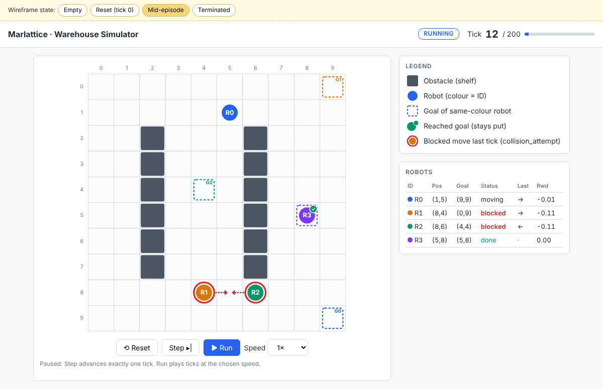
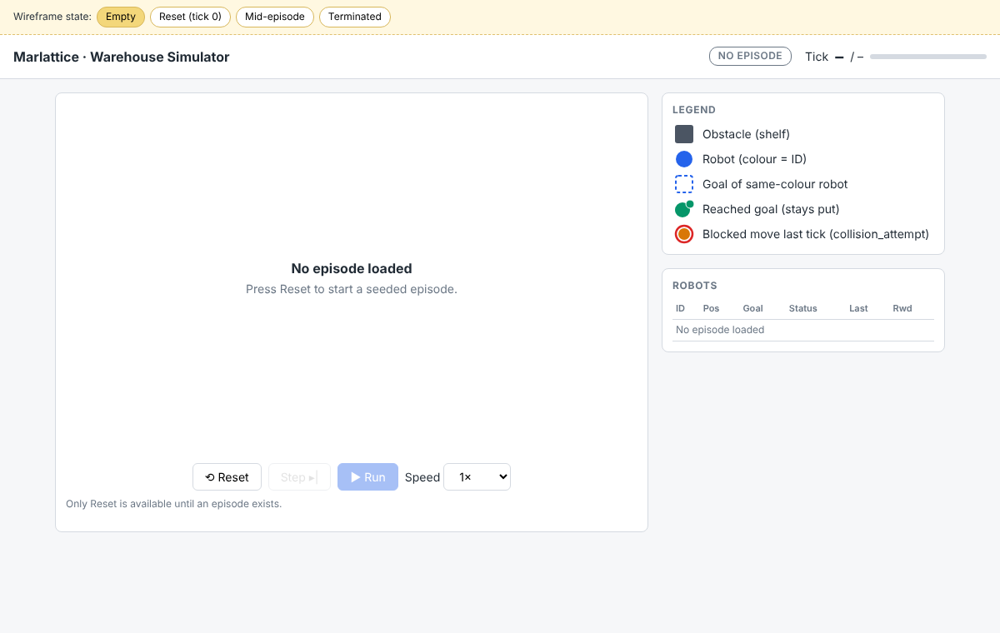
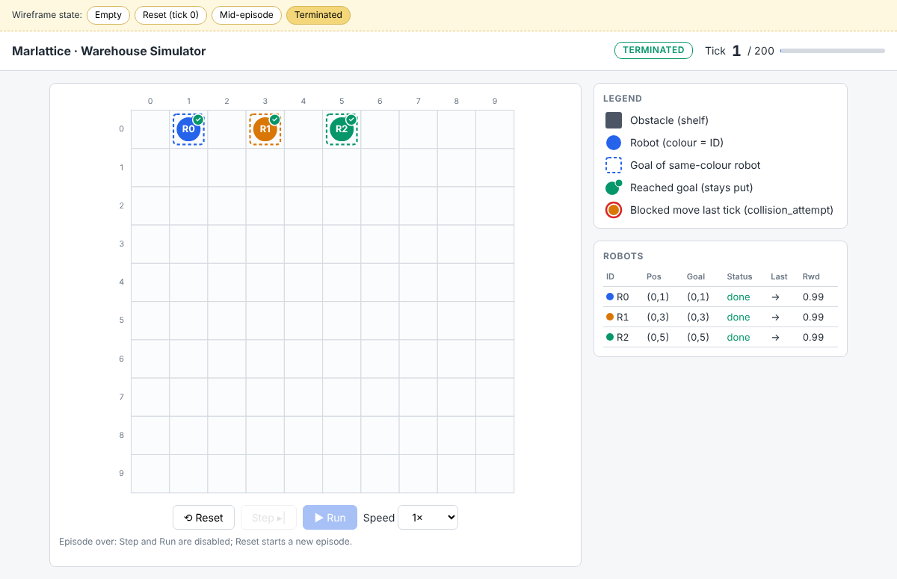

# Simulator UI: Warehouse View and Controls

**Issue:** #13 (part of #3) · **Status:** Draft, needs review by the environment owner (#2)
**Contract source:** `docs/environment-api.md` on `feat/warehouse`, section "Frontend Snapshot"

This document covers the wireframe, the controls and the data the UI reads. Rendering and playback are issue #14. Connecting the live environment is issue #15.



To see the interactive wireframe:

```bash
python3 -m http.server 8000 -d frontend
```

Then open <http://localhost:8000/design/wireframe.html> and switch between the Empty, Reset, Mid-episode and Terminated states in the yellow bar.

---

## 1. Layout

| Area | Contents |
|---|---|
| Header | Title, episode status badge (`no episode` / `running` / `terminated` / `truncated`), and **Tick `t` / `max_steps`** with a progress bar |
| Grid (main) | `grid_size × grid_size` cells with row and column labels. `(row, col)` coordinates, origin top-left, matching the env contract |
| Controls (under grid) | Reset · Step · Run/Pause · Speed |
| Legend (side) | Obstacle, robot, goal, reached-goal and blocked-move symbols |
| Robots table (side) | Per robot: ID, position, goal, status (`moving` / `blocked` / `done`), last action, last reward |

On narrow screens the side panel stacks under the grid.

## 2. Visual Encoding

| Element | Drawing | Source field |
|---|---|---|
| Obstacle | Dark filled square | `snapshot.obstacles` |
| Robot | Filled circle in the robot's colour, labelled `R0`, `R1`, … | `snapshot.robots[id].position` |
| Goal | Dashed square in the same colour, labelled `G0`, `G1`, … | `snapshot.robots[id].goal` |
| Reached goal | Green ✓ badge on the robot. The robot stays on its goal and active until the episode ends | `snapshot.robots[id].reached_goal` |
| Blocked move | Red ring around the robot plus a dashed red arrow toward the rejected cell | `last_step.collision_attempt[id]`, `last_step.actions[id]` |

Robot colours are assigned in `possible_agents` order from a palette of five (the supported 2–5 robots): blue, amber, green, purple, pink. Colour is never the only cue, because every robot and goal also carries its ID.

## 3. UI States

| State | When | Grid | Controls enabled |
|---|---|---|---|
| **Empty** | Page load, before any reset | "No episode loaded. Press Reset to start." | Reset |
| **Ready (paused)** | After reset (tick 0) or after a step | Current snapshot | Reset, Step, Run |
| **Running** | Run pressed | Updates every frame at the chosen speed | Reset, Pause, Speed |
| **Ended** | `episode_status` is `terminated` or `truncated` | Final snapshot, all robots still drawn | Reset |




## 4. Controls

| Control | Key | Behaviour |
|---|---|---|
| Reset | `R` | Asks the runner for a new episode. The UI clears its frame history and shows tick 0 |
| Step | `→` | Paused only. Asks the runner for exactly **one** tick, then shows that frame |
| Run / Pause | `Space` | Toggles continuous playback. Run changes into Pause while playing |
| Speed | — | 0.5×, 1×, 2×, 4× ticks per second relative to a 1×-speed baseline of 4 ticks/s (to tune in #14). Affects display only, never training |

**The UI never changes simulation state.** Every control sends a command (`reset`, `step`, `run`, `pause`) to the runner, and the UI only redraws from the frames it gets back. This is what #15 has to verify.

## 5. Frame Format (Proposed)

The env contract defines `env.snapshot()`. It also says the runner sends `episode_status` alongside it, and that the transport is pending frontend review. I propose the runner send one **frame** object per tick:

```json
{
  "episode_status": "running",
  "max_steps": 200,
  "snapshot": { "...": "exactly what env.snapshot() returns" },
  "last_step": {
    "actions":           { "robot_0": 4, "...": 0 },
    "rewards":           { "robot_0": -0.01, "...": 0.0 },
    "collision_attempt": { "robot_0": false, "...": false }
  }
}
```

| Field | Owner | Status | Why the UI needs it |
|---|---|---|---|
| `snapshot.tick`, `grid_size`, `obstacles`, `robots{position, goal, reached_goal}` | env | **In contract** | The grid itself |
| `episode_status` | runner | **In contract** | Status badge, disabling Step/Run at episode end |
| `max_steps` | runner | **Proposed** | "Tick 12 / 200" and the progress bar. The runner knows it from the env constructor |
| `last_step` (`null` at tick 0) | runner | **Proposed** | Showing blocked moves, last action and reward. The runner already has these from `step()`'s return values and the action dict it submitted |

None of the proposed fields need changes to `WarehouseEnv`. They come from the runner, so `snapshot()` stays as specified.

### Fixtures

| File | Scenario |
|---|---|
| `fixtures/frame_default_reset.json` | Default 10×10 layout, 3 robots, tick 0 (serpentine start/goal pairs from the contract) |
| `fixtures/frame_default_terminated.json` | Same layout after one tick: every robot arrives, `terminated` |
| `fixtures/frame_demo_tick12.json` | 10×10 with two shelf columns, 4 robots, tick 12: R1 and R2 have a vertex conflict on (8, 5), and R3 has finished |

To check the fixtures against the contract rules (in-grid cells, distinct starts and goals, nothing on obstacles, status consistency):

```bash
python3 frontend/fixtures/validate_frames.py
```

## 6. Questions for the Environment Owner (#2)

1. Is the frame envelope above OK, including `max_steps` and `last_step` from the runner?
2. Is `snapshot.robots` ordered as `possible_agents`? The UI uses that order for colours. If not, the UI will sort by ID.
3. On truncation, does the final frame have `tick == max_steps`? The validator assumes it does.
4. Transport for #15: the plan is to start with a JSON replay file (list of frames) written by the runner, then move to a live channel if time allows. Does that suit the seeded demo in #18?
